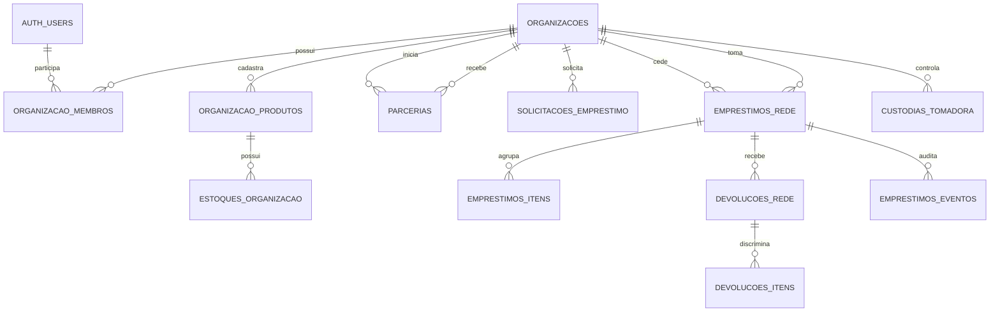
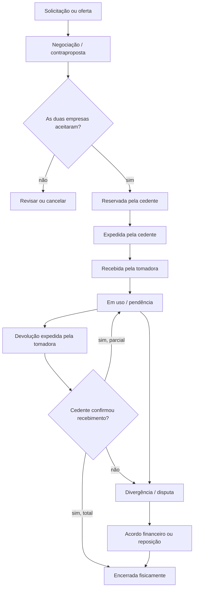

# Arquitetura alvo — Material Link Modelo B

## 1. Produto e limites de confiança

**Unidade de isolamento:** organização jurídica operadora. O Supabase Auth identifica pessoas; `organizacao_membros` identifica os poderes daquela pessoa dentro de cada organização. Um usuário pode pertencer a mais de uma organização; mudar a empresa ativa nunca altera permissões no banco.

**Unidade bilateral de negócio:** `emprestimo_rede`, com `cedente_organizacao_id` e `tomadora_organizacao_id`, ambas organizações verificadas, distintas e com parceria ativa. Uma empresa solicita e a outra aceita, ou a cedente propõe e a tomadora aceita.

**Rede inicial:** descoberta por convite/parceria. Nenhum estoque privado é indexado ou pesquisável por empresas que não sejam parceiras autorizadas.

### Contextos e módulos

| Contexto | Responsabilidades | Origem |
|---|---|---|
| Identidade e empresas | Supabase Auth, organizações, membros, papéis, convites | Novo |
| Rede de parceiros | Solicitar/aceitar parceria, bloquear, regras por par | Novo |
| Catálogo privativo | SKUs, unidades, custo, preço interno, imagens | Adaptar `produtos` |
| Vitrine publicada | Oferta visível apenas a parceiros elegíveis | Novo |
| Estoque e custódia | Saldos físicos, reservas, trânsito, posse de terceiros, kardex | Refatorar |
| Solicitações e negociação | Pedido, proposta, preços acordados, prazo, aceite duplo | Novo |
| Empréstimos bilaterais | Itens, acordos, controle de versão, estados | Refatorar `emprestimos` |
| Expedição e recebimento | Evidência de saída e confirmação de recebimento | Evoluir logística |
| Devoluções e ocorrências | Retorno, aceite pelo cedente, avaria, troca, perdas | Refatorar `devolucoes` |
| Financeiro bilateral | Valor contratual, compensação, títulos e liquidação | Novo |
| Auditoria e notificações | Eventos imutáveis, trilha por participante, avisos | Evoluir |
| Indicadores | Visão por organização: emprestado/recebido e prazos | Evoluir dashboard |

## 2. Modelo de dados — domínio alvo

**Tabelas mínimas e responsabilidades**

- `organizacoes(id, cnpj, razao_social, nome_fantasia, status, verificada_em)`: a entidade proprietária/usuária da plataforma; CNPJ validado, único após confirmação.
- `organizacao_membros(organizacao_id, usuario_id, papel, status, criado_em, aprovado_por)`: PK composta, com papéis isolados por organização; cadastro de Auth não cria associação administrativa.
- `convites_membros(id, organizacao_id, email_normalizado, token_hash, expiracao, status, criado_por)`: só o convidado com e-mail verificado pode aceitar; token não é armazenado em claro.
- `parcerias(id, solicitante_organizacao_id, convidada_organizacao_id, status, aceita_por, regras)`: convite mútuo, bloqueios, limite e prazo negociados; par de organizações canonizado para impedir duplicação invertida.
- `organizacao_produtos(id, organizacao_id, codigo, descricao, unidade, custo_centavos, venda_centavos, ...)`: UNIQUE(`organizacao_id,codigo`); `custo_centavos` nunca aparece na visão bilateral.
- `estoques_organizacao(id, organizacao_id, produto_id, local_id, disponivel, reservado, em_transito)`: FK composta ou trigger assegura que produto e saldo pertençam à mesma organização; índices (`organizacao_id, produto_id, local_id`).
- `publicacoes_rede(id, proprietaria_organizacao_id, produto_id, descricao_publica, unidade, condicoes, visibilidade)`: apenas dados explicitamente publicados a parceiros elegíveis. Disponibilidade publicada pode ser um nível/banda, não o saldo exato.
- `solicitacoes_emprestimo(id, tomadora_id, cedente_id, status, versao, validade, prazo_proposto, criado_por)`: pedidos pendentes; contraproposta exige aceite de ambas as partes antes de haver obrigação operacional.
- `emprestimos_rede(id, numero_publico, cedente_id, tomadora_id, status, versao, prazo, valor_acordado_centavos, aprovado_por_cedente, aceito_por_tomadora)`: contrato bilateral; `numero_publico` gerado no banco, com unicidade.
- `emprestimos_itens(emprestimo_id, produto_cedente_id, descricao_snapshot, unidade_snapshot, quantidade, preco_snapshot_centavos, devolvido_confirmado)`: snapshots preservam o acordo mesmo após alteração de cadastro.
- `remessas(id, emprestimo_id, sentido, expedido_por, recebido_por, timestamps, comprovante_privado)`: expedição e aceite são eventos distintos; `sentido` distingue ida/volta.
- `devolucoes_rede` e `devolucoes_itens`: proposta, quantidade expedida, recebimento físico confirmado e divergência; impedir a mesma unidade retornar duas vezes.
- `custodias_tomadora(organizacao_id, emprestimo_item_id, quantidade_recebida, quantidade_devolvida)`: controle de bem de terceiro, **fora do estoque disponível para venda**.
- `movimentacoes_rede(id, organizacao_id, produto_id, movimento, quantidade, referencia_id, idempotency_key, timestamp)`: append-only; movimentos são derivados de ações de negócio.
- `emprestimos_eventos(id, emprestimo_id, actor_organizacao_id, actor_usuario_id, evento, payload_redigido, ocorreu_em)`: trilha bilateral imutável e compartilhável apenas aos participantes.
- `notas_privadas_organizacao`, `custos_privados_organizacao`, `organizacao_auditoria`: nunca incluir campos privados de uma parte na tabela ou SELECT compartilhado.

## 3. Máquina de estados e invariantes

**Regras:**

1. Não gerar reserva de estoque sem aceite e autorização da cedente; liberar reserva em cancelamento/expiração.
2. Em expedição: descontar físico disponível na cedente **uma única vez**; registrar trânsito. Recebimento: confirmar a custódia do tomador, sem convertê-la em patrimônio/estoque próprio.
3. Em devolução: saída da custódia do tomador é um evento distinto. Reposição do saldo vendável da cedente acontece **somente depois** de conferir o retorno físico íntegro.
4. Avaria, troca, extravio e perda exigem ocorrência formal. Não repor estoque vendido automaticamente; acordo financeiro tem estado próprio.
5. Para múltiplos itens, fazer lock ordenado por `produto_id` e transação única; checar `saldo_disponivel >= quantidade` e `0 <= devolvido_confirmado <= quantidade`.
6. Nenhum cliente faz `UPDATE` direto em saldos/estado; RPC com `expected_version`, `idempotency_key` e papel/organização validados no banco.
7. Cada ação resulta em um evento de negócio único e índices de idempotência que sobrevivem a retries e queda de rede.
8. Status temporal `atrasado` deve ser derivado de prazo e saldo pendente, não gravado como verdade independente.

## 4. Matriz de autorização e visibilidade

| Recurso / ação | Cedente | Tomadora | Terceira empresa |
|---|---|---|---|
| Perfil público e parceria autorizada | Somente o autorizado | Somente o autorizado | Sem dados internos |
| Catálogo / custo / saldo privados | Sua equipe habilitada | Sua equipe habilitada | Nenhum acesso |
| Vitrine de oferta publicada | Publica | Consulta se parceira | Sem acesso sem autorização |
| Solicitação e proposta | Lê/responde | Cria/lê/responde | Nenhum acesso |
| Contrato acordado e eventos bilaterais | Lê, executa sua parte | Lê, executa sua parte | Nenhum acesso |
| Reservar/expedir estoque cedente | Papel habilitado na cedente | Não | Não |
| Confirmar recebimento no tomador | Não | Papel habilitado na tomadora | Não |
| Registrar envio de devolução | Confere quando chegar | Papel habilitado na tomadora | Não |
| Confirmar devolução e repor estoque cedente | Papel habilitado na cedente | Não | Não |
| Notas, custos e dashboards internos | Somente sua empresa | Somente sua empresa | Não |
| Cobranças e compensação | Condições bilaterais/financeiro | Condições bilaterais/financeiro | Não |

Papéis iniciais: `proprietario`, `administrador`, `comercial`, `estoque`, `financeiro`, `consulta`. Mapear permissões em matriz de capacidades por operação; `pode_aprovar`, `pode_expedir`, `pode_confirmar_recebimento`, `pode_negociar_financeiro` etc. Evitar um papel que dê poderes globais a todas as empresas.

## 5. Segurança de API / Supabase

- RLS em cada tabela exposta: consulta privada com `organizacao_id IN (SELECT ... membros ativos do auth.uid())`; dados bilaterais limitados a participantes e somente os campos intencionalmente compartilhados.
- Checar membership de ambas as partes **dentro da transação**; nunca confiar em `organizacao_id`, role, empresa ativa ou CNPJ fornecidos pelo frontend. `user_metadata` não é fonte de autorização.
- Definir helper de membership em schema **não exposto**, com `SECURITY DEFINER` somente onde indispensável e `SET search_path = ''`; revogar EXECUTE a `PUBLIC`/`anon`.
- Todas as RPCs públicas invoker; funções privilegiadas internas com checagens explícitas de participante, permissões, transição, versão e estoque. Usar `service_role` somente em tarefas administrativas seguras.
- Separar `notas_privadas` e `custos_privados`; RLS de linha **não protege colunas** dentro de uma linha compartilhada por cedente e tomadora.
- Documentos privados em Storage com caminhos vinculados ao empréstimo/organização, buckets privados, URLs temporárias autorizadas; revogar acesso após desvinculação.
- No React Query, chaves incluem `organizacao_id`, e `queryClient.clear()` é obrigatório na troca de organização; desabilitar query até autenticação e contexto estarem validados.
- Índices compostos por organização, produto, status, data e associação às duas partes; evitar múltiplos `select("*")` de milhares de registros por dashboard.

## 6. Eventos e contratos de API (propostos)

`criar_organizacao`, `convidar_membro`, `aceitar_convite`, `solicitar_parceria`, `aceitar_parceria`, `publicar_oferta`, `solicitar_emprestimo`, `propor_condicoes`, `aceitar_emprestimo`, `reservar_estoque`, `expedir_material`, `confirmar_recebimento`, `abrir_devolucao`, `expedir_devolucao`, `confirmar_devolucao`, `abrir_ocorrencia`, `acordar_compensacao`, `encerrar_emprestimo`.

Cada operação sensível recebe `organizacao_atuante_id` (somente contexto, validado), `expected_version`, `idempotency_key`, e retorna o estado autorizado e a revisão atual. A identidade de quem executa é sempre derivada de `auth.uid()`.

## 7. O que acontece com o código existente

- `src/services/cloud-service.ts`: separar em serviços `identity`, `partnerships`, `catalog`, `inventory`, `negotiations`, `loans`, `returns`, `finance`; eliminar pressupostos globais.
- `src/types/domain.ts`: manter tipos legados durante transição; criar tipos de rede novos e adaptadores explícitos, não reescrever objetos antigos silenciosamente.
- `src/hooks/use-intermat.ts`: parametrizar por organização ativa e remover acesso global a dados privados.
- `src/components/layout/app-shell.tsx`: introduzir seletor de organização, perfil e convites, com checagem de membership.
- `src/routes/empresas.tsx`: tornar diretório de parceiras e convites; `empresas` legadas não representam automaticamente organizações usuárias.
- `src/routes/produtos.tsx`: catálogo da organização e vitrine publicada em telas distintas.
- `src/routes/emprestimos.tsx`: caixas de entrada/saída, aprovações pendentes e operações compartilhadas.
- `src/routes/devolucoes.tsx`: diferenciar devolução proposta, expedida, recebida e confirmada; ocorrências.
- `src/routes/estoque.tsx`: saldos e custódia por organização.
- `src/routes/logistica.tsx`: eventos de remessa com confirmação bilateral.
- `src/routes/auditoria.tsx`: eventos por participante e logs internos separados.
- `src/routes/index.tsx`: indicadores segregados por cedente/tomadora, recebidos/pendentes e confiabilidade das parceiras.

**Nenhum esquema ou RPC existente da P0 é considerado multi-tenant por apenas adicionar uma coluna.** Cada SELECT, JOIN, dashboard, hook, trigger e transição precisa de autorização consistente.

## 8. Estratégia de preservação e migração

1. Auditar acesso ao banco real antes de qualquer migração; atualmente o projeto `sskjqromwluuzohnephz` não está conectado às contas Supabase disponíveis.
2. Snapshot e contagem de registros; migrar para staging isolado; provisionar primeiro usuário com e-mail confirmado e associação administrativa à organização correta.
3. Não pressupor que `empresas` legada (1 registro) é a loja proprietária: representa parceria, enquanto os 3.964 `produtos` são registros globais de origem não autenticada.
4. Após validar proprietário, importar/copiá-los para `organizacao_produtos` e `estoques_organizacao`; preservar IDs originais em tabela de mapeamento, registrar origem e não misturar saldos entre empresas.
5. Conciliar 28 saldos negativos e empréstimo quitado com status `aberto` sem gerar entradas/saídas artificiais; preservar evidências.
6. Fazer dual-read controlado antes do corte. Não habilitar a operação bilateral até testes de isolamento, aceites e estoque passarem com A, B e C.
7. Somente então planejar merge e implantação coordenada; nenhuma alteração de DB é realizada pelo merge de documentação.

## 9. Requisitos não funcionais iniciais

- **Integridade:** transações com locks determinísticos, idempotência e histórico append-only.
- **Segurança:** testes automatizados contra BOLA/IDOR, membership revogada, vazamento de custo e leitura cruzada entre organizações.
- **Desempenho:** paginação no servidor, índices por organização e empréstimo; não carregar catálogos completos da rede.
- **Operação:** observabilidade por `correlation_id`, migrações reversíveis onde possível, backup, logs estruturados e rate limiting.
- **Privacidade:** minimizar CPF/e-mail/telefone; dados pessoais e documentos apenas aos participantes autorizados, conforme LGPD aplicável.
